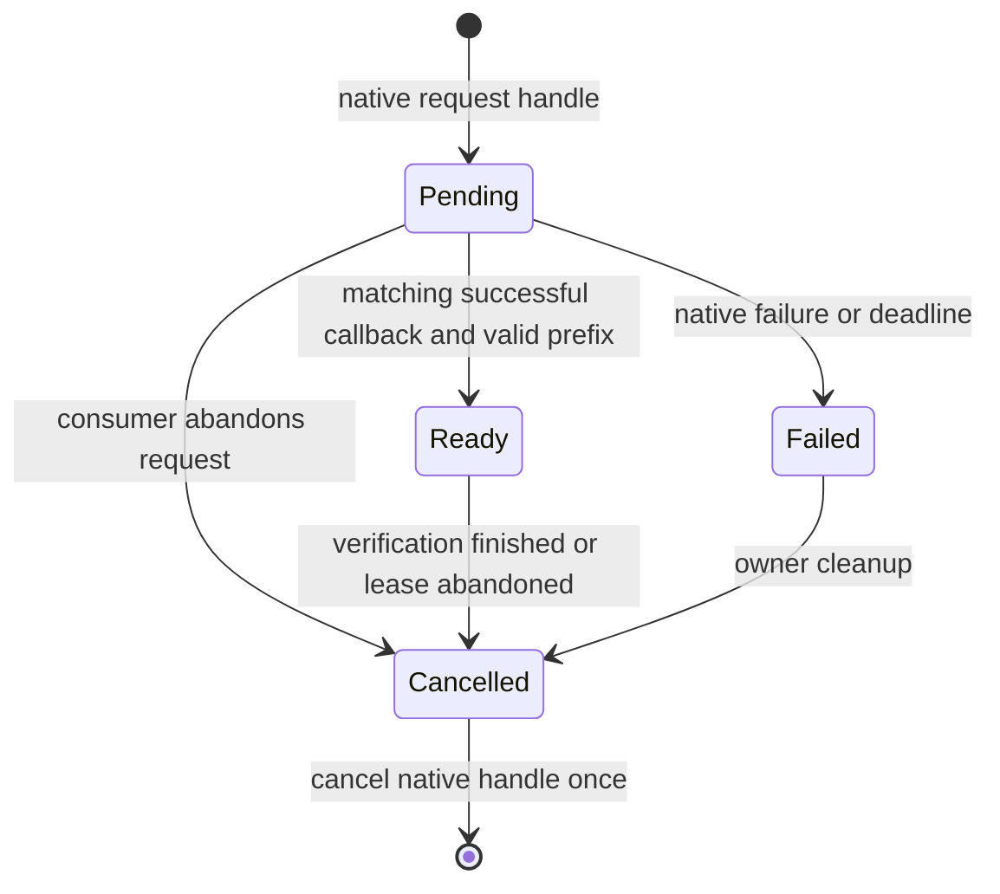

<!--
Copyright 2026 steam-api-web contributors.
SPDX-License-Identifier: Apache-2.0
Licensed under the Apache License, Version 2.0.
See LICENSE or https://www.apache.org/licenses/LICENSE-2.0 for details.
-->

# P5 native interoperability design

English | [简体中文](p5-design_ZH.md)

Status: design delivered; companion implementation and native runtime acceptance
have not started. This proposal does not add an SDK dependency to steam-api-web.
The reviewed upstream is [steamworks-rs d811418](https://github.com/Noxime/steamworks-rs/tree/d8114185613be4dbfe4897c8484d0b2670fd3cd7).
Its 25 source modules are all accounted for in the [roadmap](roadmap.md).

## Package and trust boundaries

Use a separate proposed `steam-api-web-steamworks` package. Its core owns native
ticket lifetimes and exposes raw IDs/validated byte leases; an optional `web`
feature adds conversions to steam-api-web types. The HTTP package must never
depend on the companion. A native application that only needs tickets should
not have to compile the HTTP/TLS stack, and a backend must not load Steam binaries.
Resolve the newest compatible SDK release/previews and pin the reviewed source
again when implementing; a reference commit is not a released dependency promise.

The host supplies an already initialized `steamworks::Client`. The companion
does not initialize a second SDK context, mutate SteamAppId/SteamGameId, start a
runtime or install a background callback pump. Native application code never
receives Publisher/Financial keys. A trusted backend performs ticket verification,
ownership and access-policy decisions; client-side login/ownership claims do not
authorize a backend user.

## Ticket driver and ownership

The upstream [Client](https://github.com/Noxime/steamworks-rs/blob/d8114185613be4dbfe4897c8484d0b2670fd3cd7/src/lib.rs)
is Send + Sync, and registered callbacks execute on the thread driving callbacks.
That is not a promise that application callbacks run on Tokio worker threads.
The proposed driver deliberately has one owner/pump thread for deterministic
cleanup. Its own thread restriction is an adapter policy, not an invented SDK
restriction. Existing engines keep their callback loop and call the driver's
maintenance step; an explicit one-step pump convenience may be provided.

Register and retain one callback handle before issuing requests. Bound pending
requests (initial default: 32), reject overflow before requesting another native
ticket, and use monotonic deadlines. The callback only validates/copies a bounded
payload and stages a local result; it performs no network I/O and holds no lock
across an await or user callback. Publish completions only after the native pump
returns. The reviewed upstream dispatch and callback-handle Drop use the same
registry lock, so unregistering from inside a registered callback can deadlock.
Teardown and cancellation run outside dispatch, including when host code owns the
pump; completion wakeups must not reenter cleanup while that SDK lock is held.

[AuthTicket](https://github.com/Noxime/steamworks-rs/blob/d8114185613be4dbfe4897c8484d0b2670fd3cd7/src/user.rs)
is a cancellation handle, not ticket bytes. At the reviewed revision it has Eq
but not Hash and its raw field is private. Use a bounded collection with equality
lookup, plus a local request-generation ID; do not parse Debug output or copy
private FFI layouts to build a hash key. Handle-reuse and late-callback ordering
must be confirmed against the selected SDK before production readiness is claimed.

Match the callback handle to a pending request and require its SteamResult to
succeed. Validate nonempty/NUL-free service identity before the native call;
the reviewed upstream constructs CString with unwrap. Validate ticket_len as
positive and no greater than the callback buffer; use only that prefix, since
the upstream callback copies its complete fixed buffer into a Vec. With the
optional web feature, reuse `WebApiTicket::from_callback_bytes`; never duplicate
hex encoding or permit caller-provided claims to replace callback correlation.

A ready lease keeps native cancellation ownership alive until the backend has
finished checking the ticket. Returning bytes is not successful authentication.
Dropped/expired requests mark cancellation for the owner to process; they do not
spawn asynchronous work in Drop. Keep cancellation state in the bounded registry
so a full command queue cannot silently discard cleanup. An explicit close on
the owner thread cancels outstanding handles before dropping the registration
handle and releasing the native client. Drop is a synchronous best-effort fallback.
No pump means callbacks, expiry processing and deferred cancellation cannot progress;
this limitation must be visible in the API documentation.

Late, duplicate and unmatched callbacks never complete a different request. The
driver must not hold registry locks while native cancellation or callback removal
can reenter SDK code. Pending/ready state transitions have one completion point.
Identity, ticket bytes, native callback Debug output and backend responses are
redacted; temporary owned secret buffers are cleared where ownership permits.

## Type adapters and error contracts

Use named functions or local newtypes for SteamId/AppId/GameId conversions: a
companion cannot implement a foreign From trait between two foreign ID types.
SteamId and GameId remain u64; AppId remains u32. Zero is preserved in raw
conversion, with endpoint-specific validation left to the HTTP API.

Separate local bridge failures (invalid identity/length, backpressure, deadline,
cancelled request, unexpected callback) from native SteamResult and HTTP Error.
Do not translate all failures to false or authentication success. Errors carry
structured categories/codes, not secret callback or response text.

SDK int/float stats are not equivalent to the Web write API's uint32 values.
Expose explicit checked conversion or separate operations; never silently round,
truncate a float, cast a negative value or turn a missing callback into zero.

## Complete module disposition

| Source modules | P5 disposition |
| --- | --- |
| lib, callback, error | Injected client, explicit pumping/teardown and separate error domains. |
| user | Correlated Web API ticket lease, service identity, checked callback prefix and explicit cancellation. |
| app, friends, utils | ID/type interoperability; installation, overlays, avatars and client UI remain upstream native operations. |
| user_stats, user_stats/stat_callback, user_stats/stats | Checked numeric mapping and explicit asynchronous completion; native stats/leaderboard workflows remain upstream. |
| ugc, remote_storage | Preserve published-file IDs; distinguish native synchronization from explicit HTTP Cloud/UGC stages. |
| matchmaking, matchmaking_servers, server | Explicit lifecycle/session bridging; native server queries and lobby callbacks are not replaced by Web calls. |
| networking, networking_messages, networking_sockets, networking_sockets_callback, networking_types, networking_utils | Delegate packet transport, connection state, identities and relay behavior to the native SDK. No HTTP emulation. |
| input, remote_play, screenshots, timeline | Native device/render/session features, accessed through upstream APIs; no invented HTTP counterpart. |

The companion connects native and Web workflows; it is not a second implementation
of all upstream SDK bindings. Adding a read-only conversion does not mark a native
feature, callback workflow or production integration complete.

## Implementation work packages and acceptance

| Package | Deliverable | Required evidence |
| --- | --- | --- |
| P5.1 | Raw ID adapters, local errors and bounded ticket state machine behind a testable native port | Boundary IDs, orphan-rule-safe APIs, failure/cancel/duplicate/late callbacks, backpressure and completion exactly once. |
| P5.2 | steamworks-rs adapter and explicit owner-driver lifecycle | Real callback registration, correct handle matching, NUL-free identity, length checks, cancellation and clean teardown. |
| P5.3 | Optional web-type conversion and trusted-backend example | Effective prefix bytes, no Publisher key in a game client, single-send verification, verification-before-cancellation and no secret logs. |
| P5.4 | Platform/runtime acceptance | Linux, macOS and Windows builds plus authorized Steam AppID runtime tests with a running client and proper licenses. |

Fake-driver tests must include success, native failure, negative/zero/oversized
length, zero/full-width IDs, unknown/duplicate callbacks, receiver abandonment,
deadline, shutdown with pending requests and callback reentrancy. Real-SDK tests
must verify handle reuse/cancellation ordering and callback-pump behavior. These
runtime checks require a suitable Steam environment; none were executed for this
design. The HTTP crate's default dependency graph, AWS-LC configuration, release
archive allowlist and independent no-SDK consumer build remain regression gates.
