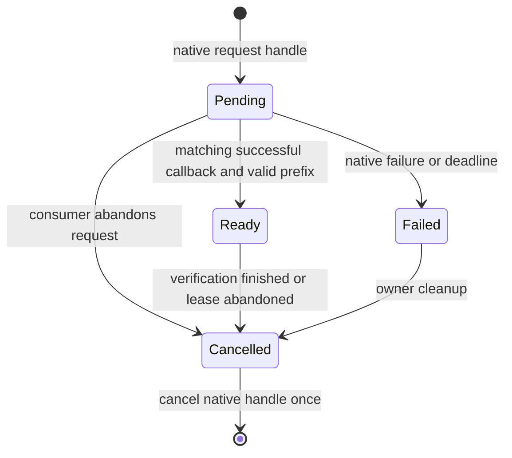

<!--
Copyright 2026 steam-api-web contributors.
SPDX-License-Identifier: Apache-2.0
Licensed under the Apache License, Version 2.0.
See LICENSE or https://www.apache.org/licenses/LICENSE-2.0 for details.
-->

# P5 原生互操作设计

[English](p5-design.md) | 简体中文

状态：设计已交付，companion 实现与原生运行验收尚未开始。此提案不向 steam-api-web
加入 SDK 依赖。核对的上游为 [steamworks-rs d811418](https://github.com/Noxime/steamworks-rs/tree/d8114185613be4dbfe4897c8484d0b2670fd3cd7)，
25 个源码模块均已列入[路线图](roadmap_ZH.md)。

## 包与信任边界

拟采用独立 `steam-api-web-steamworks` 包，核心负责原生票据生命周期，输出原始 ID
及经过验证的字节 lease；可选 `web` feature 才加入 steam-api-web 类型转换。
HTTP 包永不反向依赖 companion。仅需要票据的游戏客户端无需编译 HTTP/TLS 栈，
后端也不加载 Steam 动态库。实施时重新选择最新兼容的 SDK 稳定/预发布版本并核对
固定源码；参考提交不等于已发布依赖承诺。

由宿主注入已初始化的 `steamworks::Client`。companion 不二次初始化 SDK，不修改
SteamAppId/SteamGameId，不创建运行时或后台回调循环。游戏客户端不持有 Publisher/
Financial key；票据验证、所有权与访问决策由可信后端完成，客户端声称已登录或拥有
游戏不能成为后端授权依据。

## 票据驱动与所有权

上游 [Client](https://github.com/Noxime/steamworks-rs/blob/d8114185613be4dbfe4897c8484d0b2670fd3cd7/src/lib.rs)
是 Send + Sync，但回调在驱动回调的线程执行，不保证由 Tokio worker 执行。本设计
主动采用一个 owner/pump 线程，使清理顺序确定；这是适配层策略，不是虚构 SDK 限制。
已有引擎保留自己的循环并执行 driver 维护步骤，也可提供显式的单步 pump 便捷方法。

先注册并持有一个 callback handle，再申请票据。限制在途请求数量（建议默认 32），
超限时先拒绝再调用 SDK，截止时间使用单调时钟。回调只做有界校验/复制并完成本地
请求结果，不发送网络请求，不跨 await 或用户回调持有锁；原生 pump 返回后再发布完成
通知。已核对上游分发和 callback-handle Drop 使用同一注册表锁，注册回调内部注销
可能死锁。因此关闭/取消在分发之外执行，即使宿主自己驱动 pump 也必须遵守；完成
通知的唤醒不得在 SDK 持锁时重入清理。

[AuthTicket](https://github.com/Noxime/steamworks-rs/blob/d8114185613be4dbfe4897c8484d0b2670fd3cd7/src/user.rs)
是取消句柄，不是票据字节；核对版本支持 Eq、不支持 Hash，原始字段私有。因此用
有界集合做相等匹配，并维护本地请求 generation ID，不解析 Debug、不复制私有 FFI
布局来构造哈希键。SDK 句柄复用与迟到回调顺序必须在选定版本上验证后，才能宣称生产就绪。

只接受与在途请求句柄匹配且 SteamResult 成功的回调。调用 SDK 前拒绝空 identity 或
NUL；已核对上游使用 CString 的 unwrap。ticket_len 必须大于零且不超过回调缓冲，
只使用有效前缀，因为上游将整个固定缓冲复制到 Vec。启用 web feature 时复用
`WebApiTicket::from_callback_bytes`，不重复实现 hex，也不以调用方声明替代回调关联。

Ready lease 必须持续持有取消权，直到后端完成票据检查；返回字节不代表认证成功。
丢弃/超时只标记取消，由 owner 处理，不在 Drop 中启动异步任务。在有界注册表中保留
取消状态，避免命令队列满时丢失清理。显式 close 在 owner 线程先取消未完成句柄，
再释放 callback handle 和 native client；Drop 仅作同步尽力清理。没有 pump 时，
回调、超时处理及延迟取消都无法推进，这个边界必须写入 API 文档。

迟到、重复或未知回调不能完成其他请求。SDK 取消/注销可能重入时，不持有注册表锁。
Pending/Ready 的完成点只能触发一次。identity、票据字节、原生 callback Debug 和
后端响应均脱敏，并在所有权允许时清零临时秘密缓冲。

## 类型转换与错误契约

使用命名函数或本地 newtype 转换 SteamId/AppId/GameId；companion 无法在两个外部
ID 类型之间实现外部 From trait。SteamId/GameId 保留 u64，AppId 保留 u32。
原始转换保留零，是否允许零仍由具体 HTTP 方法校验。

本地错误（identity/长度错误、背压、超时、取消、回调不匹配）与 native SteamResult、
HTTP Error 分开。不能把所有失败归为 false，也不能把回调成功等同于 HTTP 授权成功；
错误保留结构化类别/码，不含票据、回调或服务器秘密文本。

SDK 的 int/float 统计不等价于 Web 写入的 uint32。提供显式检查转换或独立操作，
不得静默舍入浮点、截断负值，或把缺失回调变成零。

## 全模块去向

| 源码模块 | P5 处理边界 |
| --- | --- |
| lib、callback、error | 注入 client、显式 pump/释放、独立错误域。 |
| user | 关联 Web API 票据 lease、identity、有效前缀与显式取消。 |
| app、friends、utils | ID/类型互操作；安装、覆盖层、头像及客户端 UI 沿用上游原生操作。 |
| user_stats、user_stats/stat_callback、user_stats/stats | 数值检查转换与显式异步完成；原生统计/排行榜流程继续由上游实现。 |
| ugc、remote_storage | 保留文件 ID；区分原生同步与显式 HTTP Cloud/UGC 阶段。 |
| matchmaking、matchmaking_servers、server | 显式生命周期/会话桥接；原生查询及大厅回调不由 Web 调用替代。 |
| networking、networking_messages、networking_sockets、networking_sockets_callback、networking_types、networking_utils | 数据包、连接状态、身份和中继交给原生 SDK，不模拟 HTTP 替代。 |
| input、remote_play、screenshots、timeline | 设备、渲染和原生会话功能继续使用上游 API，不虚构 HTTP 对应。 |

companion 连接原生与 Web 工作流，不重复实现所有 SDK 绑定。只增加只读转换，不能
将原生功能、回调流程或生产集成标记为完成。

## 实施包与验收

| 实施包 | 交付物 | 必需证据 |
| --- | --- | --- |
| P5.1 | 原始 ID 适配、本地错误、有界票据状态机及可测试 native port | ID 边界、合法 orphan-rule API、失败/取消/重复/迟到回调、背压与恰好完成一次。 |
| P5.2 | steamworks-rs 适配与显式 owner-driver 生命周期 | 真实回调注册、句柄关联、identity NUL 校验、长度、取消和完整释放。 |
| P5.3 | 可选 Web 类型转换及可信后端示例 | 有效前缀、客户端无 Publisher key、验证单次发送、先验证后取消、无秘密日志。 |
| P5.4 | 平台/运行验收 | Linux/macOS/Windows 构建，使用运行中的 Steam client、合适 AppID 和许可做授权运行测试。 |

fake-driver 测试应覆盖成功、native 失败、负/零/超长长度、零/完整宽度 ID、未知/重复
回调、接收方丢弃、超时、带在途请求关闭和回调重入；真实 SDK 还要验证句柄复用、取消
顺序和 pump 行为。本设计未执行这些原生运行检查。HTTP 包默认依赖图、AWS-LC 配置、
发布归档白名单以及无 SDK 的独立消费者构建仍是回归门槛。
